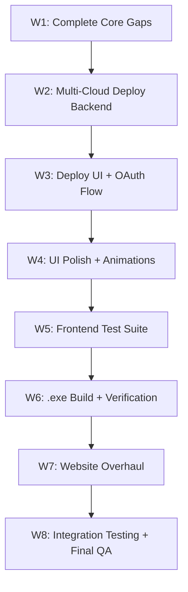

# Sentryɸ — Final Master Workflow Plan v2.0

**Created:** 2026-11-02  
**Scope:** Everything remaining to reach a fully functional, submission-ready product  
**Supersedes:** `context/IMPLEMENTATION_PHASES.md` (v1.0, P1–P9)

---

> [!IMPORTANT]
> This plan was produced after a deep audit of every file in the project. It accounts for what is **actually built**, what is **partially done**, and what is **completely missing**. No DeepTeam. AgentGuardian is deferred to after garak+pyrit are production-stable.

---

## Current State Audit (as of 2026-11-02)

### ✅ What Is Fully Working

| Layer | Component | Tests |
|-------|-----------|-------|
| Frontend UI | 11 screens (Agreement→Deploy) | 0 (needs P-FT) |
| Electron Shell | main.cjs + preload.cjs + IPC bridge | — |
| IPC Server | JSON Lines protocol, stdin/stdout | 23 tests |
| Mock Engine | Deterministic test data | 75 tests |
| Garak Adapter | Subprocess CLI, 21 probes, 6 categories | 30 tests |
| PyRIT Adapter | Python SDK, 12 attacks, 6 categories | 30 tests |
| Normalization | OWASP LLM Top 10 mapping, Jaccard dedup | 50 tests |
| Scorer | Risk score 0–100, severity classifier | 72 tests |
| Recommender | Per-category remediation actions | 48 tests |
| Report Generator | JSON + TXT export, ScanReport assembly | 69 tests |
| Export Handler | PDF (WeasyPrint), JSON, CSV | 46 tests |
| PyInstaller Build | scripts/build-python.py | — |
| **Total backend** | | **1105 tests ✅** |

### ⚠️ What Is Partially Built (Needs Completion)

| Component | Status | Gap |
|-----------|--------|-----|
| Deploy Config (Screen 9) | UI built, AWS-only | No Azure/GCP config; no OAuth sign-in flow |
| Cloud Compare (Screen 10) | UI built, static data | No real pricing API; no Azure/GCP comparison |
| Deploy Execute (Screen 11) | UI built, dry-run sim | No real provisioning; no sign-in redirect |
| Engine selection in UI | `engine` field passed to IPC | UI doesn't expose engine picker to user |
| OWASP coverage in UI | Data sent in `complete` event | Frontend doesn't render coverage map |

### ❌ What Is Completely Missing

| Component | Description |
|-----------|-------------|
| **Multi-cloud deployment backend** | AWS boto3, Azure SDK, GCP SDK engines |
| **OAuth/CLI sign-in flow** | AWS SSO, Azure AD, GCP OAuth redirect |
| **Real cost estimation** | Pricing API integration (AWS/Azure/GCP) |
| **Recommended deployment settings** | Auto-generate settings from scan results |
| **UI polish pass** | Animations, micro-interactions, professional feel |
| **Frontend tests** | Zero frontend tests (vitest + playwright) |
| **Website updates** | No mention of multi-cloud, no schema markup, no Core Web Vitals optimization |
| **App icon** | No .ico/.icns/.png for installer |
| **.exe build verification** | PyInstaller bundle not tested end-to-end |

---

## Phase Plan — Execution Order



---

# ═══════════════════════════════════════════════════════
# W1 — COMPLETE CORE GAPS (Pre-deploy foundation)
# ═══════════════════════════════════════════════════════

**Goal:** Fix all loose ends in the existing pipeline before adding cloud deployment.

### W1.1 — Engine Selector in UI
- Add engine picker dropdown to ConfigPage (Screen 3): `auto` / `garak` / `pyrit` / `mock`
- `auto` = run both garak + pyrit in parallel, merge results
- Wire selection through `ScanContext` → IPC config → `engine_runner.py`
- Show engine availability status (green/yellow/red dot)

### W1.2 — OWASP Coverage Map in Results
- Render the `normalization.coverage_map` data on ResultsPage (Screen 6)
- Show 10 OWASP categories as a grid: tested ✓ / findings ⚠ / not covered ○
- Visual heatmap style (green → yellow → red)

### W1.3 — Recommended Deployment Settings Generator
- New backend module: `core/deploy/recommendation_engine.py`
- Input: `ScanReport` (risk_score, findings by category, severity distribution)
- Output: `DeploymentRecommendation` containing:
  - Recommended provider (based on model type + risk level)
  - Security group rules (restrictive if high-risk findings)
  - Guardrail configuration (if Bedrock/Azure AI Safety)
  - Estimated monthly cost range per provider
  - Rationale text for each recommendation
- Wire into ipc_server.py as a new step after report assembly

### W1.4 — App Icon Generation
- Generate Sentryɸ logo as `.ico` (256×256 multi-res), `.icns` (macOS), `.png` (1024×1024)
- Place in `app/frontend/public/`
- Update `package.json` build config references

**Deliverables:** 4 sub-tasks, ~2 hours each
**Tests:** Unit tests for recommendation engine, snapshot test for OWASP grid

---

# ═══════════════════════════════════════════════════════
# W2 — MULTI-CLOUD DEPLOYMENT BACKEND
# ═══════════════════════════════════════════════════════

**Goal:** Build real deployment engines for AWS, Azure, and GCP. Each engine follows the same interface: `plan → validate → deploy → verify → rollback`.

### W2.1 — Deploy Engine Interface
Create `core/deploy/__init__.py` and `core/deploy/base.py`:

```python
class BaseDeployEngine(ABC):
    @abstractmethod
    def validate_credentials(self, creds: dict) -> CredentialStatus
    @abstractmethod
    def generate_plan(self, config: DeployConfig) -> DeployPlan
    @abstractmethod
    def estimate_cost(self, plan: DeployPlan) -> CostEstimate
    @abstractmethod
    def dry_run(self, plan: DeployPlan) -> DryRunResult
    @abstractmethod
    def deploy(self, plan: DeployPlan) -> DeployResult
    @abstractmethod
    def rollback(self, deployment_id: str) -> RollbackResult
    @abstractmethod
    def get_auth_url(self) -> str  # OAuth redirect URL
```

### W2.2 — AWS Deploy Engine (`core/deploy/aws_engine.py`)
Using `boto3`:
- **Auth:** AWS SSO (`aws sso login`) or access key + secret key or IAM role
- **OAuth flow:** Generate SSO login URL → user signs in via browser → callback with temp credentials
- **Plan generation:** IAM Role, VPC + SG, API Gateway + Lambda OR SageMaker endpoint, CloudWatch, Budget Alert
- **Cost estimation:** AWS Pricing API (`pricing.describe_services`) for real-time pricing
- **Deploy:** Actually provision via boto3 calls (behind explicit confirmation)
- **Rollback:** Tag-based cleanup (`SentryPhi: true` tag on all resources)
- **Safety:** Dry-run is DEFAULT. Live deploy requires 2-step confirmation modal.

### W2.3 — Azure Deploy Engine (`core/deploy/azure_engine.py`)
Using `azure-identity` + `azure-mgmt-*`:
- **Auth:** Azure AD OAuth2 (`InteractiveBrowserCredential`) → redirect to Microsoft login
- **Resources:** Resource Group, Azure AI Services endpoint, NSG, App Service / Container Instance
- **Cost estimation:** Azure Retail Prices API (REST, no SDK needed)
- **Deploy:** `azure-mgmt-resource` deployment client
- **Safety:** Same 2-step confirmation as AWS

### W2.4 — GCP Deploy Engine (`core/deploy/gcp_engine.py`)
Using `google-cloud-*`:
- **Auth:** Google OAuth2 (`google-auth-oauthlib`) → redirect to Google sign-in
- **Resources:** GCP Project, Vertex AI Endpoint, VPC, Cloud Run / Cloud Functions, Monitoring
- **Cost estimation:** GCP Cloud Billing Catalog API
- **Deploy:** `google-cloud-aiplatform` + `google-cloud-resource-manager`
- **Safety:** Same 2-step confirmation

### W2.5 — Private Cloud / Self-Hosted Option
- Generate deployment configs (Docker Compose, Kubernetes YAML, systemd service)
- No cloud auth needed — just export files
- Templates for: Nginx reverse proxy + model server + monitoring stack

### W2.6 — Deploy IPC Endpoints
New IPC handlers in `ipc_server.py` and `electron/main.cjs`:
```
deploy:auth-url         → get OAuth redirect URL for provider
deploy:validate-creds   → check if credentials are valid
deploy:generate-plan    → create deployment plan
deploy:estimate-cost    → get real cost estimate
deploy:dry-run          → validate against cloud APIs
deploy:execute          → provision resources (with confirmation)
deploy:rollback         → tear down deployment
deploy:status           → check deployment status
```

### W2.7 — Tests
- `tests/test_aws_deploy.py` — mocked with `moto` library
- `tests/test_azure_deploy.py` — mocked with `unittest.mock`
- `tests/test_gcp_deploy.py` — mocked with `unittest.mock`
- `tests/test_deploy_interface.py` — interface contract tests
- No real cloud calls in tests. All mocked.

**Deliverables:** 7 sub-tasks
**Dependencies:** boto3, azure-identity, azure-mgmt-resource, google-cloud-aiplatform, google-auth-oauthlib

---

# ═══════════════════════════════════════════════════════
# W3 — DEPLOY UI + OAUTH SIGN-IN FLOW
# ═══════════════════════════════════════════════════════

**Goal:** Rebuild Screens 9–11 to support multi-cloud deployment with real OAuth sign-in.

### W3.1 — Provider Selection Screen (Replace Screen 9)
After scan results, show:
1. **Recommended settings card** (from W1.3) with rationale
2. **Provider cards:** AWS / Azure / GCP / Private — each showing:
   - Estimated monthly cost (from pricing API)
   - Security features available
   - Compliance certifications
   - "Sign In" button (for cloud providers) or "Export Config" (for private)
3. **Cost comparison table** across all 3 providers for the selected settings

### W3.2 — OAuth Sign-In Flow
When user clicks "Sign In to AWS/Azure/GCP":
1. Backend generates OAuth URL → `deploy:auth-url`
2. Electron opens the URL in the system default browser (`shell.openExternal`)
3. Backend starts a temporary local HTTP server (localhost:PORT) to receive the OAuth callback
4. User signs in on the provider's website
5. Provider redirects to `http://localhost:PORT/callback?code=...`
6. Backend exchanges code for credentials (never stored on disk — session-only)
7. Electron IPC notifies frontend: "Signed in as user@domain.com ✓"
8. Frontend unlocks the provider-specific config panel

### W3.3 — Provider-Specific Config Panel
After sign-in, show provider-specific deployment options:
- **AWS:** Region, Bedrock/SageMaker/Lambda mode, instance type, VPC config, budget alert
- **Azure:** Region, AI Services/Container/App Service, resource group, NSG rules
- **GCP:** Region, Vertex AI/Cloud Run, project ID, VPC, budget alert
- Real-time cost estimate updates as user changes settings

### W3.4 — Deploy Confirmation + Execution (Replace Screen 11)
1. Show full deployment plan (every resource to be created)
2. Show total estimated cost (monthly + one-time)
3. Two-step confirmation: "Review Plan" → "Confirm & Deploy"
4. Live deployment progress with step-by-step status
5. Success: show endpoint URL + resource summary
6. Failure: automatic rollback + error details

### W3.5 — Deploy Types Update
Update `services/deployTypes.ts`:
- Add Azure and GCP region lists, instance types, deployment modes
- Add `OAuthState`, `CredentialStatus`, `CostEstimate` types
- Add `DeploymentRecommendation` type (from W1.3)
- Update `DeployContext` reducer for multi-provider state

**Deliverables:** 5 sub-tasks

---

# ═══════════════════════════════════════════════════════
# W4 — UI POLISH + PROFESSIONAL ANIMATIONS
# ═══════════════════════════════════════════════════════

**Goal:** Make the app look and feel like a premium, professional security product.

### W4.1 — Design System Overhaul
- Refined color palette: deep navy (#0a0f1a) + electric cyan (#00d4ff) + amber warnings
- Typography: Inter (primary) + JetBrains Mono (code/data)
- Spacing scale: 4px base grid
- Border radius system: sm(4px) / md(8px) / lg(12px) / xl(16px)
- Shadow depth levels: sm / md / lg / xl (glassmorphism for cards)

### W4.2 — Micro-Animations (CSS + React)
- Page transitions: slide + fade (150ms ease-out)
- Button hover: scale(1.02) + glow + ripple effect
- Card hover: translateY(-2px) + shadow elevation
- Progress bar: shimmer animation during scan
- Findings list: staggered entrance animation (each item 50ms delay)
- Risk score: animated counter (0 → final score over 1.5s)
- OWASP grid: sequential reveal animation
- Deploy progress: step-by-step reveal with check marks

### W4.3 — Data Visualization
- Risk score: animated radial gauge (0–100) with color gradient
- Severity distribution: horizontal stacked bar chart
- OWASP coverage: interactive heatmap grid
- Cost comparison: grouped bar chart (AWS vs Azure vs GCP)
- Scan timeline: animated progress tracker with timestamps

### W4.4 — Responsive Layout Polish
- Sidebar navigation (persistent on large screens, collapsible on small)
- Card-based layouts with consistent spacing
- Loading states: skeleton screens (not spinners)
- Error states: friendly illustrations + retry buttons
- Empty states: helpful placeholder content

### W4.5 — Accessibility Pass
- ARIA labels on all interactive elements
- Keyboard navigation for entire wizard flow
- Focus indicators (visible, high contrast)
- Screen reader announcements for scan progress
- Color contrast: WCAG AA minimum

**Deliverables:** 5 sub-tasks

---

# ═══════════════════════════════════════════════════════
# W5 — FRONTEND TEST SUITE
# ═══════════════════════════════════════════════════════

**Goal:** Comprehensive frontend testing (0 tests → full coverage).

### W5.1 — Test Infrastructure
- Install vitest, @testing-library/react, @testing-library/jest-dom, jsdom
- Configure vitest.config.ts with react plugin
- Create test setup file with jest-dom matchers
- Mock `window.electronAPI` globally for all tests

### W5.2 — Unit Tests — State Management
- `ScanContext.test.tsx` — reducer, actions, initial state
- `ReportContext.test.tsx` — report actions, filter, sort
- `DeployContext.test.tsx` — deploy config, provider selection, OAuth state

### W5.3 — Component Tests — All 11+ Pages
- One test file per page component
- Test rendering, user interactions, navigation triggers
- Test form validation (InputPage, ConfigPage, DeployConfigPage)
- Test data display (ResultsPage, ActionsPage, ExportPage)

### W5.4 — Integration Tests
- Full wizard flow: Screen 1 → Screen 11
- Theme toggle (dark/light)
- Engine selection → scan → results → deploy flow

### W5.5 — E2E Tests (Playwright)
- Launch Vite dev server
- Navigate all screens
- Simulate a mock scan → verify results
- Test export flow

**Deliverables:** 5 sub-tasks
**Target:** 200+ frontend tests

---

# ═══════════════════════════════════════════════════════
# W6 — .EXE BUILD + VERIFICATION
# ═══════════════════════════════════════════════════════

**Goal:** Produce a working Windows installer and verify it on a clean environment.

### W6.1 — PyInstaller Bundle
- Run `npm run build:python` — verify ipc_server.exe is produced
- Verify garak + pyrit are bundled in the exe
- Test: run the .exe standalone, pipe JSON config, verify output

### W6.2 — Electron Builder
- Run `npm run build:electron` — produce NSIS installer
- Verify: installer runs, installs to %LOCALAPPDATA%\Sentryphi
- Verify: app launches, scan works, report exports, deploy flow reaches sign-in

### W6.3 — First-Launch Health Check
- On first launch, app checks:
  - ✓ Python backend (bundled exe)
  - ✓ Garak engine availability
  - ✓ PyRIT engine availability
  - Shows status screen before allowing scans
- If engine unavailable → graceful fallback to MockEngine with warning

### W6.4 — Uninstaller Verification
- Verify: uninstaller removes all files
- Verify: no leftover registry entries
- Verify: desktop shortcut and start menu entry removed

**Deliverables:** 4 sub-tasks

---

# ═══════════════════════════════════════════════════════
# W7 — WEBSITE OVERHAUL
# ═══════════════════════════════════════════════════════

**Goal:** Update the marketing website with all new features, SEO best practices, and performance optimization.

### W7.1 — Content Update
- Update hero section: "Multi-Cloud LLM Security Platform" (not just AWS)
- Add features section: Garak + PyRIT engines, OWASP coverage, multi-cloud deploy
- Add cloud provider logos (AWS, Azure, GCP)
- Add deployment flow animation/diagram
- Update download page with system requirements

### W7.2 — Technical/On-Page SEO & Schema Markup
- Add JSON-LD structured data:
  - `SoftwareApplication` schema (name, OS, category, offers)
  - `Organization` schema
  - `FAQPage` schema on docs page
  - `BreadcrumbList` on all pages
- Meta tags: unique title + description per page
- Open Graph + Twitter Card meta tags
- Canonical URLs on all pages
- `robots.txt` + XML sitemap generation
- Alt text on all images

### W7.3 — Speed Optimization, Core Web Vitals & Caching
- Next.js Image component (`next/image`) for all images — automatic WebP, lazy loading
- Font optimization: `next/font` with font-display: swap
- Code splitting: dynamic imports for below-fold sections
- CSS: purge unused styles, critical CSS inlining
- Headers: Cache-Control, ETag for static assets
- Lighthouse target: Performance ≥ 95, Accessibility ≥ 95, SEO ≥ 95
- Core Web Vitals targets: LCP < 2.5s, FID < 100ms, CLS < 0.1

### W7.4 — Keyword-Targeted Content Creation
- Blog post: "How to Scan Your LLM for Security Vulnerabilities Before Deployment"
- Blog post: "OWASP LLM Top 10: What Every Developer Should Know"
- Docs page: Getting Started guide with screenshots
- Docs page: Engine comparison (Garak vs PyRIT)
- FAQ section with common questions

### W7.5 — Backlink Implementation
- Add Sentryɸ to:
  - GitHub Topics: `llm-security`, `ai-safety`, `red-teaming`
  - Product Hunt listing preparation
  - OWASP community resources page (if applicable)
  - Dev.to / Hashnode blog cross-posts
  - Reddit r/MachineLearning, r/LocalLLaMA posts
- Add badges: GitHub stars, license, build status

**Deliverables:** 5 sub-tasks

---

# ═══════════════════════════════════════════════════════
# W8 — INTEGRATION TESTING + FINAL QA
# ═══════════════════════════════════════════════════════

**Goal:** End-to-end verification of the complete product.

### W8.1 — Backend Integration Tests
- Full pipeline: config → manifest → scan (mock) → normalize → score → recommend → report
- Full pipeline with garak adapter (against httpbin.org test endpoint)
- Full pipeline with pyrit adapter (against httpbin.org test endpoint)
- Deploy plan generation (mocked cloud APIs)
- Export: JSON + PDF + CSV verification

### W8.2 — Electron Integration Tests
- Launch app → complete scan → export report → verify file on disk
- Launch app → scan → deploy flow → OAuth mock → plan → verify
- Test with all 3 engines: mock, garak, pyrit
- Test error cases: invalid target, engine unavailable, network timeout

### W8.3 — Cross-Model Compatibility
- Test with OpenAI-compatible APIs (different response formats)
- Test with local models (llama.cpp endpoint)
- Test with Azure OpenAI endpoint format
- Verify engine adapters handle diverse response structures

### W8.4 — Final QA Checklist
- [ ] All 11 screens render correctly (dark + light theme)
- [ ] Scan completes with mock engine (< 5 seconds)
- [ ] Scan completes with garak engine (against test endpoint)
- [ ] Scan completes with pyrit engine (against test endpoint)
- [ ] Report exports: JSON ✓ PDF ✓ CSV ✓
- [ ] OWASP coverage map displayed correctly
- [ ] Deploy flow: provider selection → sign-in → config → plan → confirm
- [ ] Cost estimates display for all 3 providers
- [ ] .exe installer works on clean Windows
- [ ] Uninstaller works completely
- [ ] Website loads < 2.5s (LCP)
- [ ] Lighthouse scores: Performance ≥ 95, SEO ≥ 95
- [ ] All backend tests pass (target: 1200+)
- [ ] All frontend tests pass (target: 200+)

**Deliverables:** 4 sub-tasks

---

## Execution Timeline

| Week | Phases | Focus |
|------|--------|-------|
| 1 | W1 (all) + W2.1–W2.2 | Core gaps + AWS engine |
| 2 | W2.3–W2.7 + W3.1–W3.2 | Azure/GCP engines + OAuth flow |
| 3 | W3.3–W3.5 + W4.1–W4.3 | Deploy UI + polish |
| 4 | W4.4–W4.5 + W5 (all) | Accessibility + frontend tests |
| 5 | W6 (all) + W7.1–W7.3 | .exe build + website core |
| 6 | W7.4–W7.5 + W8 (all) | Content + final QA |

---

## Dependencies Map

```
W1 ← no dependencies (start immediately)
W2 ← W1.3 (recommendation engine needed for deploy plans)
W3 ← W2 (backend deploy engines must exist before UI)
W4 ← W3 (polish after functional completeness)
W5 ← W4 (test the final polished UI)
W6 ← W5 (build after tests pass)
W7 ← W1 (website can start after core gaps fixed)
W8 ← W6 + W7 (final QA after everything built)
```

---

## Key Technical Decisions for This Plan

| # | Decision | Rationale |
|---|----------|-----------|
| W-D1 | OAuth via system browser + localhost callback | Most secure; no embedded browser credential exposure |
| W-D2 | Session-only credentials (never stored on disk) | D-017 compliance; credentials in process memory only |
| W-D3 | DeepTeam replaced by AgentGuardian (DEFERRED) | Per user request; will add after garak+pyrit stable |
| W-D4 | All 3 cloud providers get real deployment | Expands v1 scope beyond D-022 (was AWS-only) |
| W-D5 | Private/self-hosted = config export (no auth) | No cloud sign-in needed; just generate Docker/K8s configs |
| W-D6 | Cost estimation uses provider pricing APIs | Real-time pricing, not static estimates |

---

## Python Dependencies to Add

```toml
# In pyproject.toml [project.optional-dependencies]
cloud = [
    "boto3>=1.35.0",           # AWS SDK
    "moto>=5.0.0",             # AWS mock for tests
    "azure-identity>=1.17.0",  # Azure OAuth
    "azure-mgmt-resource>=23.0.0",  # Azure deployment
    "google-cloud-aiplatform>=1.60.0",  # GCP Vertex AI
    "google-auth-oauthlib>=1.2.0",      # GCP OAuth
]
```

---

## File Structure After Completion

```
app/backend/core/deploy/
├── __init__.py
├── base.py                    # BaseDeployEngine ABC
├── aws_engine.py              # AWS boto3 implementation
├── azure_engine.py            # Azure SDK implementation
├── gcp_engine.py              # GCP SDK implementation
├── private_engine.py          # Docker/K8s config export
├── recommendation_engine.py   # Auto-generate deploy settings
├── cost_estimator.py          # Pricing API integrations
└── oauth_server.py            # Localhost OAuth callback server

app/backend/tests/
├── test_aws_deploy.py
├── test_azure_deploy.py
├── test_gcp_deploy.py
├── test_deploy_interface.py
├── test_recommendation_engine.py
└── test_cost_estimator.py

app/frontend/src/pages/
├── ... (existing 11 pages)
├── ProviderSelectPage.tsx     # New: provider comparison + sign-in
└── DeployProgressPage.tsx     # New: live deployment progress

app/frontend/src/services/
├── ... (existing)
├── oauthService.ts            # OAuth flow management
└── costTypes.ts               # Cost estimation types
```

---

*End of Master Workflow Plan v2.0*  
*Total phases: 8 (W1–W8), 39 sub-tasks*  
*Estimated effort: 6 weeks*
